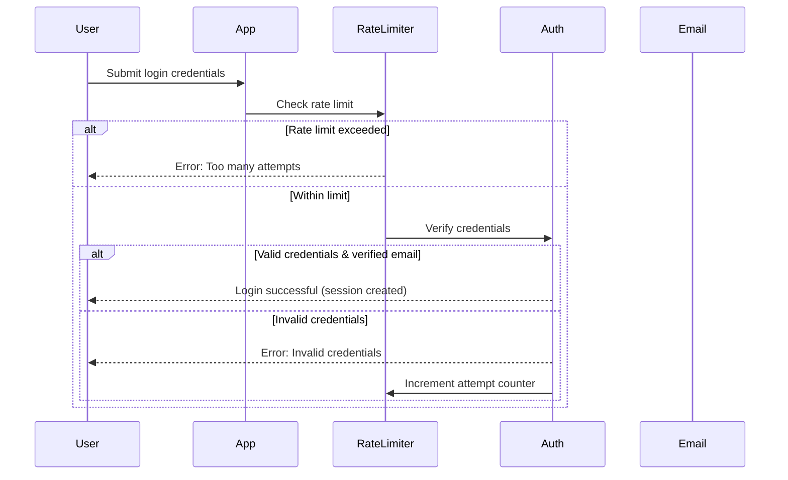
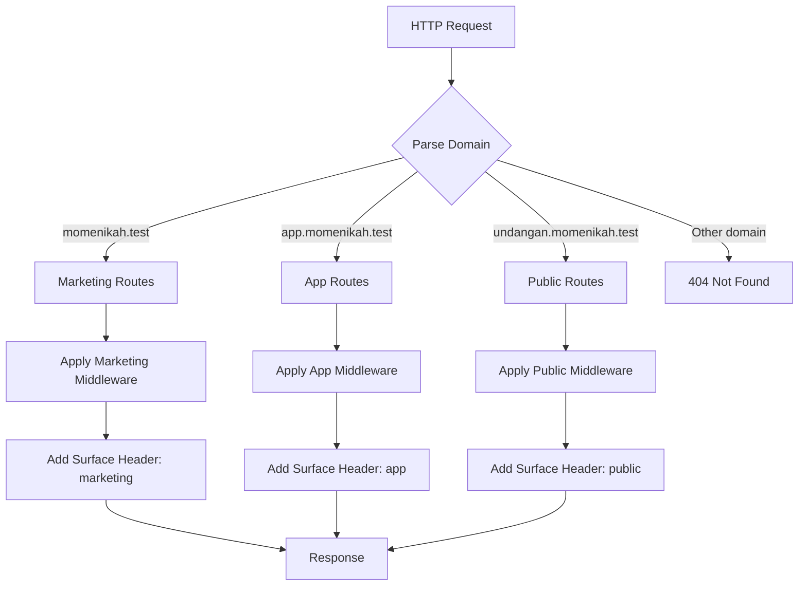
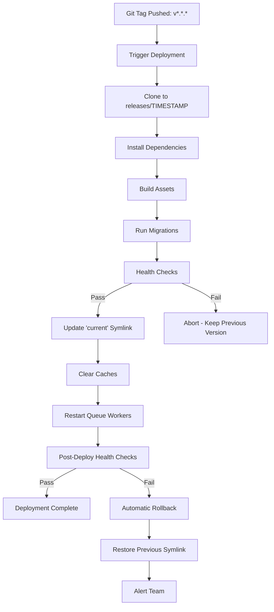

# Design Document: FND-Fondasi-M0

## Overview

The FND-Fondasi-M0 milestone establishes the foundational infrastructure for Momenikah, a Laravel-based event invitation platform. This design implements a modular monolithic architecture with strict domain isolation, three distinct web surfaces (marketing, application, and public invitations), and comprehensive development and deployment infrastructure.

The design prioritizes developer experience through containerized local development, automated quality gates, and zero-downtime deployment capabilities. Security is enforced at multiple layers through architectural tests, rate limiting, and comprehensive security headers including surface-specific Content Security Policies.

## Architecture

### High-Level Architecture

The system follows a modular monolithic architecture with clear separation between:

1. **Domain Layer** (`app/Domain/*`): Pure business logic with no framework dependencies
2. **Presentation Layer** (`app/Http`, `app/Livewire`, `app/Filament`): Framework-specific entry points
3. **Infrastructure Layer**: Database, cache, queues, and external services

This architecture enforces unidirectional dependency flow: Presentation → Domain, but never Domain → Presentation. This isolation is enforced through automated Pest architecture tests that fail the build if violations are detected.

### Multi-Surface Architecture

The application serves three distinct surfaces on separate domains:

- **Marketing Surface** (`momenikah.test`): Public marketing website with SEO optimization
- **App Surface** (`app.momenikah.test`): Authenticated user dashboard and admin panel
- **Public Surface** (`undangan.momenikah.test`): Stateless public invitation viewer

Each surface has:
- Dedicated route files (`routes/marketing.php`, `routes/app.php`, `routes/public.php`)
- Surface-specific middleware stacks
- Independent Content Security Policies
- Surface identifier in response headers for debugging

### Domain Routing Strategy

Laravel 13's `Route::domain()` method enables subdomain-based routing. Routes are organized by registering each surface's route file in `bootstrap/app.php` with domain constraints:

```php
// Conceptual example - not implementation code
Route::domain('momenikah.test')->group(base_path('routes/marketing.php'));
Route::domain('app.momenikah.test')->group(base_path('routes/app.php'));
Route::domain('undangan.momenikah.test')->group(base_path('routes/public.php'));
```

Order matters: subdomain routes must be registered before root domain routes to prevent the root domain from matching subdomain requests. A 404 handler catches requests to unrecognized domains.

## Components and Interfaces

### Repository Foundation

**Component**: Git repository configuration

**Purpose**: Establish version control, branch protection, and editor consistency

**Key Files**:
- `.gitignore`: Excludes `vendor/`, `node_modules/`, `.env`, `storage/*`, `*.map`, `*.log`, `dist/`, `build/`, `public/build/`
- `.editorconfig`: Defines `indent_style=space`, `indent_size=4` for PHP, `indent_size=2` for JS, `end_of_line=lf`, `charset=utf-8`, `trim_trailing_whitespace=true`
- `.claude/`: Project documentation and context for AI assistants

**Branch Protection Rules**:
- Minimum 1 pull request review required
- All CI checks must pass before merge
- Direct pushes to `main` branch rejected

### Laravel Application and Docker Environment

**Component**: Laravel 13 application with containerized services

**Purpose**: Provide consistent local development environment

**Technology Stack**:
- Laravel 13.x (requires PHP 8.3.0 - 8.4.999)
- MySQL 8.4.x (port 3306)
- Redis 7.x+ (port 6379)
- Docker Compose for orchestration

**Docker Compose Structure**:

```yaml
# Conceptual structure - not full implementation
services:
  mysql:
    image: mysql:8.4
    ports: ["3306:3306"]
    volumes: [mysql_data:/var/lib/mysql]
    
  redis:
    image: redis:7
    ports: ["6379:6379"]
    volumes: [redis_data:/data]

volumes:
  mysql_data:
  redis_data:
```

**Health Checks**:
- Database: `php artisan migrate:status` must exit 0
- Cache: `php artisan cache:clear` must exit 0
- Application: `php artisan about` displays correct versions

**Error Handling**:
- If Docker daemon not running: Exit with clear error message
- If ports already in use: Exit with port conflict error message

### Code Quality Pipeline

**Component**: Automated code quality enforcement

**Purpose**: Ensure all code meets quality standards before merge

**Tools**:

1. **Laravel Pint** (version 1.x+)
   - Configuration: `pint.json` at repository root
   - Execution: `./vendor/bin/pint --test` in CI
   - Timeout: 300 seconds
   - Purpose: Enforce Laravel coding standards

2. **Larastan** (version 2.x+)
   - Configuration: `phpstan.neon` or `phpstan.neon.dist` at repository root
   - Execution: `./vendor/bin/phpstan analyse` in CI
   - Timeout: 600 seconds
   - Configuration includes inline comment documenting analysis level (0-9) and rationale
   - Purpose: Static analysis to catch type errors and bugs

3. **Pest** (version 2.x+)
   - Configuration: `phpunit.xml` or `pest.php` at repository root
   - Execution: `php artisan test` or `./vendor/bin/pest` in CI
   - Timeout: 900 seconds
   - Purpose: Automated testing including architecture tests

4. **Frontend Build**
   - Execution: `npm run build` in CI
   - Timeout: 600 seconds
   - Purpose: Verify frontend assets compile successfully

**GitHub Actions Workflow**:

Location: `.github/workflows/ci.yml` (or `.yaml`)

Triggers:
- Pull request opened
- Pull request updated (synchronized)

Jobs run in parallel where possible. If any job exits non-zero, the pull request is marked as failed and cannot be merged due to branch protection rules.

Pull request status checks display:
- ✓/✗ Linter (Pint)
- ✓/✗ Static Analysis (Larastan)
- ✓/✗ Tests (Pest)
- ✓/✗ Build (npm)

### Domain-Driven Architecture with Enforcement

**Component**: Directory structure and architecture tests

**Purpose**: Isolate business logic from framework concerns

**Directory Structure**:

```
app/
├── Domain/           # Business logic (no framework dependencies)
│   └── [Domains]/    # Individual domain modules
├── Http/             # HTTP controllers
├── Livewire/         # Livewire components
└── Filament/         # Filament admin resources
```

**Architecture Test Implementation** (Pest):

The architecture tests use Pest's architecture testing DSL to enforce dependency rules. Tests are located in `tests/Feature/Architecture` or `tests/Architecture` and run as part of the standard test suite.

Key architecture tests:

1. **Domain Layer Isolation**:
   ```php
   // Conceptual example - validates no presentation imports
   test('domain layer does not depend on presentation')
       ->expect('App\Domain')
       ->not->toUse([
           'App\Http',
           'App\Livewire',
           'App\Filament'
       ]);
   ```

2. **Domain Directory Existence**:
   Test fails if `app/Domain/` directory does not exist

3. **Violation Reporting**:
   When violations are detected, error messages include:
   - The violating class name
   - The forbidden dependency that was imported
   - Clear guidance on how to fix

**Execution**:
- Via `composer test` (configured in composer.json scripts)
- Via `php artisan test`
- Completes within 30 seconds

**Rationale**: This architecture supports long-term maintainability by preventing business logic from becoming tightly coupled to framework-specific concerns. Domain code can be tested in isolation and is easier to reason about.

### Multi-Surface Configuration System

**Component**: Surface-specific routing and configuration

**Purpose**: Serve three distinct web experiences from a single codebase

**Configuration File** (`config/surfaces.php`):

```php
// Conceptual structure
return [
    'marketing' => [
        'domain' => 'momenikah.test',
        'name' => 'Marketing Website',
        // Additional surface-specific config
    ],
    'app' => [
        'domain' => 'app.momenikah.test',
        'name' => 'Application Dashboard',
        // Additional surface-specific config
    ],
    'public' => [
        'domain' => 'undangan.momenikah.test',
        'name' => 'Public Invitations',
        // Additional surface-specific config
    ],
];
```

**Route Files**:

1. `routes/marketing.php`: Marketing surface routes
2. `routes/app.php`: Application surface routes
3. `routes/public.php`: Public surface routes

**Bootstrap Configuration** (`bootstrap/app.php`):

Routes are registered during application initialization. If any route file fails to load, the application logs an error indicating which file failed and halts initialization.

**Response Headers**:

Each response includes a custom header identifying the surface (e.g., `X-Surface: marketing`) for debugging and monitoring purposes.

**Root Path Behavior**:

Each surface's root path (`/`) renders a page containing text identifying the surface name, confirming correct routing.

**Performance**:

All surfaces respond within 2 seconds for standard requests.

### Staging Deployment Infrastructure

**Component**: Automated deployment with zero downtime

**Purpose**: Safe, reliable staging deployments with monitoring and recovery

**Deployment Strategy**: Symbolic Link Swap (Laravel Forge-style)

This approach creates new releases in a `releases/` directory and uses symbolic links to activate them:

```
/var/www/app/
├── current -> releases/20250124_120000/  # Symlink to active release
├── releases/
│   ├── 20250124_120000/  # New release
│   ├── 20250124_100000/  # Previous release (kept for rollback)
│   └── ...
├── shared/           # Shared across releases
│   ├── storage/
│   └── .env
```

**Deployment Process**:

1. **Preparation Phase**:
   - Clone new code into `releases/TIMESTAMP/`
   - Install Composer dependencies
   - Build frontend assets
   - Link shared directories (storage, .env)
   - Run database migrations

2. **Verification Phase**:
   - Test database connectivity
   - Send HTTP health check to new release
   - Wait maximum 120 seconds for health checks to pass
   - If health checks fail: abort and retain previous version

3. **Activation Phase**:
   - Atomically update `current` symlink to point to new release
   - Clear caches (route, config, view)
   - Restart queue workers
   - Maximum 30 seconds of service unavailability

4. **Monitoring Phase**:
   - If deployment fails after traffic switch: automatic rollback within 60 seconds
   - Keep previous release for fast rollback

**Trigger Mechanism**:

Deployment initiates within 5 minutes when a Git tag matching pattern `v*.*.*` (e.g., `v1.0.0`, `v2.1.3`) is pushed to the repository.

**Backup System**:

- **Schedule**: Daily at 02:00 UTC
- **Retention**: Minimum 7 days, maximum 30 days
- **Concurrency**: If backup already in progress, wait for completion before starting next backup
- **Verification**: Backup restore tests verify row counts match backup manifest
- **Storage**: Backups stored with timestamp and retained according to retention policy

**Monitoring with Sentry**:

- **Configuration**: DSN and environment identifier set to "staging"
- **Error Reporting**: Unhandled exceptions reported within 60 seconds
- **HTTP 500 Errors**: Automatically reported to Sentry with stack trace
- **Integration**: Installed via `sentry/sentry-laravel` package

**Rollback Procedures**:

Documented in deployment script comments or separate documentation file:

1. Manual rollback: Update `current` symlink to previous release
2. Automatic rollback: Triggered if post-deployment health checks fail
3. Database rollback: Restore from most recent backup

**Health Check Endpoints**:

Simple HTTP endpoint that verifies:
- Database connectivity (can execute simple query)
- Redis connectivity (can ping cache)
- Returns HTTP 200 if all checks pass

### Authentication System

**Component**: Laravel Livewire authentication starter kit with rate limiting

**Purpose**: Secure user authentication with protection against brute force attacks

**Technology**: Official Laravel Livewire Starter Kit

**Features Provided**:

1. **User Registration**:
   - Creates user account
   - Sends verification email within 5 seconds
   - Rate limit: 3 attempts per IP address per 600 seconds

2. **User Login**:
   - Authenticates valid credentials
   - Requires verified email
   - Establishes session within 2 seconds
   - Rate limit: 5 attempts per email address per 60 seconds

3. **Password Reset**:
   - Sends reset link to registered email within 5 seconds
   - Validates reset token
   - Updates password and invalidates token

4. **Email Verification**:
   - Marks email as verified within 2 seconds
   - Uses signed URLs for verification links

**Rate Limiting Strategy**:

Laravel's built-in rate limiting (configured in `app/Providers/RouteServiceProvider.php` or route definitions):

1. **Login Throttling**:
   - Limit: 5 attempts per email address per 60 seconds
   - Key: User's email address
   - Lockout duration: 60 seconds after 6th attempt
   - Error message: Displays remaining lockout time

2. **Registration Throttling**:
   - Limit: 3 attempts per IP address per 600 seconds
   - Key: User's IP address
   - Error message: Displays retry time

3. **Automatic Expiry**:
   - Rate limits automatically reset after time window expires
   - New authentication attempts allowed immediately after expiry

**Integration**:

- Uses Laravel's `User` model (typically `App\Models\User`)
- Integrates with Laravel's authentication system
- Uses Laravel's session management
- Email sending via Laravel's mail system

**Testing Requirements**:

Automated Pest tests verify:
- ✓ Successful registration with email verification
- ✓ Successful login with valid credentials
- ✓ Login rejection with invalid credentials
- ✓ Complete password reset flow
- ✓ Email verification flow
- ✓ Rate limiting triggers after 6 failed login attempts
- ✓ Rate-limited users cannot login until lockout expires

### Security Headers and CSP Middleware

**Component**: HTTP security headers middleware with surface-specific CSP

**Purpose**: Protect against common web vulnerabilities (XSS, clickjacking, MIME sniffing)

**Implementation Approach**: Custom middleware or package-based (e.g., `spatie/laravel-csp` or custom)

**Global Security Headers** (applied to all surfaces):

```
X-Content-Type-Options: nosniff
X-XSS-Protection: 1; mode=block
Referrer-Policy: strict-origin-when-cross-origin
```

**Environment-Specific Headers**:

Production environment only:
```
Strict-Transport-Security: max-age=31536000; includeSubDomains
```

**Surface-Specific Headers**:

**X-Frame-Options**:
- Marketing Surface: `DENY`
- App Surface: `DENY`
- Public Surface: `SAMEORIGIN` (allows embedding in own site)

**Content Security Policy Configuration**:

Each surface has a distinct CSP configuration to balance security with functionality needs:

**Marketing Surface CSP**:
```
default-src 'self';
script-src 'self' 'unsafe-inline';
style-src 'self' 'unsafe-inline';
img-src 'self' data:;
font-src 'self';
```

Rationale: `unsafe-inline` allowed for scripts and styles to support marketing tools, analytics, and dynamic content.

**App Surface CSP**:
```
default-src 'self';
script-src 'self';
style-src 'self' 'unsafe-inline';
img-src 'self' data:;
font-src 'self';
```

Rationale: No inline scripts (more secure). Inline styles allowed for Livewire and CSS-in-JS libraries. This is the most restrictive CSP.

**Public Surface CSP**:
```
default-src 'self';
script-src 'self';
style-src 'self' 'unsafe-inline';
img-src 'self' data:;
font-src 'self';
```

Rationale: Similar to App Surface. No inline scripts. Inline styles for invitation templates.

**CSP Implementation Strategy**:

1. Create middleware that adds CSP header based on current surface
2. Middleware reads surface identifier from request
3. Applies appropriate CSP from configuration
4. Middleware registered globally or per-surface route group

**CSP Configuration Storage**:

Stored in `config/surfaces.php` alongside surface configuration, or in dedicated `config/csp.php` file with surface-specific sections.

**Verification**:

Security header scanner verification in staging environment:
- Use tools like securityheaders.com or Mozilla Observatory
- Must report zero critical security header violations
- Scan all three surfaces independently

### Third-Party License Documentation

**Component**: Centralized dependency license tracking

**Purpose**: Legal compliance and awareness of usage rights

**File Location**: `THIRD_PARTY.md` at repository root

**Document Structure**:

```markdown
# Third-Party Licenses

Last Updated: YYYY-MM-DD

## GSAP (GreenSock Animation Platform)

- **License**: Commercial or Free (specify which)
- **Usage**: [Description of how GSAP is used]
- **Commercial License Status**: [Acquired / Using free features only]
- **Reference**: https://gsap.com/licensing/

## Fonts

### Cormorant Garamond
- **License**: SIL Open Font License (OFL)
- **Source**: [URL to font source]

### Plus Jakarta Sans
- **License**: SIL Open Font License (OFL)
- **Source**: [URL to font source]

## Composer Packages

| Package Name | Version | License |
|--------------|---------|---------|
| laravel/framework | 13.x | MIT |
| [package] | [version] | [license] |

## npm Packages

| Package Name | Version | License |
|--------------|---------|---------|
| [package] | [version] | [license] |
```

**Maintenance Process**:

1. **Initial Population**: Document all packages from initial `composer.json` and `package.json`
2. **Add Dependency**: When adding package, update `THIRD_PARTY.md` in same commit
3. **Remove Dependency**: When removing package, remove entry from `THIRD_PARTY.md` in same commit
4. **Update Timestamp**: Update "Last Updated" date when making changes

**GSAP Special Consideration**:

GSAP requires either:
- Commercial license for commercial projects
- Use only free features (documented in THIRD_PARTY.md)

Document must state acquisition status or explicitly state "using free features only" with reference to GSAP's licensing page.

**Automation Considerations**:

Future enhancement: Add git pre-commit hook or CI check to verify `THIRD_PARTY.md` is updated when `composer.json` or `package.json` changes.

## Data Models

### User Model

Standard Laravel User model with authentication fields:

```php
// Conceptual structure
class User extends Authenticatable
{
    protected $fillable = ['name', 'email', 'password'];
    protected $hidden = ['password', 'remember_token'];
    protected $casts = ['email_verified_at' => 'datetime'];
}
```

**Database Migration**:

Laravel's default users table migration with fields:
- `id`: Primary key
- `name`: User's full name
- `email`: Unique email address
- `email_verified_at`: Timestamp of email verification
- `password`: Hashed password
- `remember_token`: For "remember me" functionality
- `created_at`, `updated_at`: Timestamps

### Configuration Models

No database-backed models for configuration. Surface configuration stored in `config/surfaces.php` as array data.

## Data Flow Diagrams

### Authentication Flow



### Multi-Surface Request Routing



### Deployment Flow



## Error Handling

### Docker Environment Errors

**Error**: Docker daemon not running
- **Detection**: Docker commands fail with connection errors
- **Response**: Exit with clear error message: "Docker daemon is not running. Please start Docker and try again."
- **Recovery**: User starts Docker daemon manually

**Error**: Port conflicts (3306 or 6379 already in use)
- **Detection**: Docker Compose fails to bind ports
- **Response**: Exit with error message specifying which port(s) are in use
- **Recovery**: User stops conflicting services or changes port mapping in `docker-compose.yml`

### CI Pipeline Errors

**Error**: Linter fails (Pint)
- **Detection**: `./vendor/bin/pint --test` exits non-zero
- **Response**: CI marks pull request as failed, display Pint output
- **Recovery**: Developer runs `./vendor/bin/pint` locally to fix, pushes changes

**Error**: Static analysis fails (Larastan)
- **Detection**: `./vendor/bin/phpstan analyse` exits non-zero
- **Response**: CI marks pull request as failed, display Larastan errors
- **Recovery**: Developer fixes type errors, pushes changes

**Error**: Tests fail (Pest)
- **Detection**: `php artisan test` exits non-zero
- **Response**: CI marks pull request as failed, display test failures
- **Recovery**: Developer fixes failing tests, pushes changes

**Error**: Build fails (npm)
- **Detection**: `npm run build` exits non-zero
- **Response**: CI marks pull request as failed, display build errors
- **Recovery**: Developer fixes build issues, pushes changes

### Architecture Test Violations

**Error**: Domain layer imports presentation layer
- **Detection**: Pest architecture test detects forbidden import
- **Response**: Test fails with message: "Class `App\Domain\Orders\OrderService` should not depend on `App\Http\Controllers\OrderController`"
- **Recovery**: Developer refactors to remove dependency, typically by:
  - Moving shared logic to domain layer
  - Using dependency injection
  - Creating proper interfaces

### Route Loading Errors

**Error**: Route file fails to load
- **Detection**: Exception during application bootstrap
- **Response**: Log error indicating which route file failed, halt initialization
- **Example**: "Failed to load route file: routes/marketing.php - Syntax error on line 23"
- **Recovery**: Developer fixes syntax error in route file

### Deployment Errors

**Error**: Health checks fail during deployment
- **Detection**: Health endpoint returns non-200 status or times out after 120 seconds
- **Response**: Abort deployment, retain previous version
- **Logging**: Log health check failures with details
- **Recovery**: Investigate health check failures, fix issues, re-deploy

**Error**: Post-deployment failure detected
- **Detection**: Monitoring detects elevated error rates or failed health checks
- **Response**: Automatic rollback within 60 seconds
- **Process**: Restore previous `current` symlink, clear caches, restart workers
- **Recovery**: Investigate deployment issues, fix, re-deploy

### Authentication Errors

**Error**: Rate limit exceeded (login)
- **Detection**: More than 5 login attempts in 60 seconds for an email
- **Response**: Block further attempts, display error with countdown: "Too many login attempts. Please try again in 45 seconds."
- **Recovery**: Wait for lockout period to expire, or use password reset

**Error**: Rate limit exceeded (registration)
- **Detection**: More than 3 registration attempts in 600 seconds from an IP
- **Response**: Block further attempts, display error with retry time
- **Recovery**: Wait for rate limit to expire

**Error**: Unverified email on login
- **Detection**: User attempts login with valid credentials but unverified email
- **Response**: Reject login, display message: "Please verify your email address before logging in"
- **Recovery**: User clicks verification link in email

### Security Header Errors

**Error**: Security scan reports violations
- **Detection**: External security scanner reports missing or misconfigured headers
- **Response**: CI/staging verification fails (if automated), or manual review catches issue
- **Recovery**: Update security middleware configuration to address violations
- **Prevention**: Regular security scans in staging environment

## Testing Strategy

### Unit Tests

**Purpose**: Test individual components in isolation

**Focus Areas**:
- Domain layer business logic
- Configuration parsing (`config/surfaces.php`)
- Utility functions
- Model methods

**Example Test Cases**:
- User model correctly hashes passwords
- Surface configuration returns correct domain for each surface
- Email validation logic works correctly

### Feature Tests

**Purpose**: Test complete features and user flows

**Focus Areas**:
- Authentication flows (registration, login, password reset, email verification)
- Multi-surface routing
- Rate limiting behavior
- Security header presence and correctness

**Example Test Cases**:
- User can register, receive verification email, verify email, and login
- Requests to `momenikah.test` route to marketing surface
- 6 failed login attempts trigger rate limiting
- All responses include correct security headers for their surface

### Architecture Tests

**Purpose**: Enforce architectural boundaries

**Framework**: Pest architecture testing

**Location**: `tests/Feature/Architecture` or `tests/Architecture`

**Test Cases**:

1. **Domain Isolation Test**:
   - Verifies `App\Domain` does not import from `App\Http`, `App\Livewire`, or `App\Filament`
   - Execution time: < 30 seconds

2. **Domain Directory Existence**:
   - Verifies `app/Domain/` directory exists

3. **Future Tests** (as architecture grows):
   - Individual domains don't depend on each other (except via contracts)
   - Specific namespace organization rules

### Integration Tests

**Purpose**: Test interactions with external systems

**Focus Areas**:
- Database connectivity and queries
- Redis cache operations
- Email sending
- External API integrations (future)

**Example Test Cases**:
- Can connect to MySQL and execute migrations
- Can connect to Redis and store/retrieve cache values
- Can send email through configured mail driver

### End-to-End Tests

**Purpose**: Test complete user journeys (future enhancement)

**Tools**: Laravel Dusk or similar

**Focus Areas**:
- Complete authentication flows in browser
- Multi-surface navigation
- Form submissions and validations

### Test Execution

**Local Development**:
- `composer test` or `php artisan test`: Runs all tests
- `./vendor/bin/pest --filter=Architecture`: Runs only architecture tests

**CI Pipeline**:
- All tests run automatically on pull request
- Tests must pass before merge
- Timeout: 900 seconds (15 minutes)

**Test Database**:
- Use SQLite in-memory database for fast tests
- Or dedicated test database configured in `phpunit.xml`

### Test Coverage Goals

- **Domain Layer**: 80%+ coverage
- **Authentication System**: 100% coverage of critical paths
- **Architecture Tests**: 100% coverage of defined rules

## Implementation Notes

### Phase 1: Foundation Setup (Requirements 1-2)

1. Initialize Git repository with `.gitignore`, `.editorconfig`
2. Configure branch protection rules on GitHub
3. Install Laravel 13 with PHP 8.3+
4. Create `docker-compose.yml` with MySQL 8.4 and Redis 7.x
5. Configure Laravel database and cache connections
6. Verify `php artisan about`, `migrate:status`, `cache:clear` commands work

### Phase 2: Quality Tools (Requirement 3)

1. Install Laravel Pint, Larastan, Pest via Composer
2. Create configuration files (`pint.json`, `phpstan.neon`, `phpunit.xml`)
3. Create GitHub Actions workflow at `.github/workflows/ci.yml`
4. Configure parallel job execution where possible
5. Test workflow by opening a pull request

### Phase 3: Architecture Setup (Requirement 4)

1. Create `app/Domain/` directory structure
2. Create architecture tests in `tests/Architecture/DomainIsolationTest.php`
3. Add `composer test` script to `composer.json`
4. Verify tests pass with empty domain directory
5. Document architecture guidelines in comments or docs

### Phase 4: Multi-Surface Configuration (Requirement 5)

1. Create `config/surfaces.php` configuration file
2. Create three route files: `routes/marketing.php`, `routes/app.php`, `routes/public.php`
3. Register routes in `bootstrap/app.php` with domain constraints
4. Create middleware to add surface identifier headers
5. Configure local DNS (edit `/etc/hosts` or use Laravel Valet/Herd)
6. Test each domain in browser

### Phase 5: Deployment Infrastructure (Requirement 6)

1. Set up staging server with SSH access
2. Create deployment script (e.g., using Deployer or custom bash script)
3. Configure directory structure with `releases/`, `current`, `shared/`
4. Implement health check endpoint
5. Configure database backup system (cron job + mysqldump)
6. Install and configure Sentry
7. Create Git tag trigger for deployments
8. Test deployment and rollback procedures

### Phase 6: Authentication (Requirement 7)

1. Install Laravel Livewire authentication starter kit
2. Configure rate limiting in routes or middleware
3. Test authentication flows manually
4. Write comprehensive Pest tests for all auth flows and rate limiting
5. Verify tests pass

### Phase 7: Security Headers (Requirement 8)

1. Create security headers middleware
2. Implement surface-specific CSP logic
3. Add environment-specific headers (HSTS in production only)
4. Register middleware globally
5. Test headers in browser dev tools or with curl
6. Run security header scanner on staging environment

### Phase 8: License Documentation (Requirement 9)

1. Create `THIRD_PARTY.md` at repository root
2. Document GSAP license status
3. Document fonts (Cormorant Garamond, Plus Jakarta Sans)
4. Extract and document all Composer packages from `composer.json`
5. Extract and document all npm packages from `package.json`
6. Add last-updated timestamp
7. Consider adding pre-commit hook for future automation (optional)

## References

### Official Documentation
- [Laravel 13 Routing Documentation](https://laravel.com/docs/13.x/routing) - Domain routing and route groups
- [Laravel 13 Middleware Documentation](https://laravel.com/docs/13.x/middleware) - Security headers and CSP implementation
- [Pest Architecture Testing](https://pestphp.com/docs/arch-testing) - Architecture test syntax and examples

### Implementation Guides
- "Laravel Tips: Just Enough Domain Driven Design using Pest Architecture Tests" - [Medium Article](https://medium.com/curology-tech/laravel-tips-just-enough-domain-driven-design-using-pest-architecture-tests-d5b7b0ecd0a2) - Modular monolith patterns with Pest enforcement
- Laravel Forge Zero-Downtime Deployment - Symbolic link deployment strategy
- Understanding and Implementing Content Security Policy (CSP) in Laravel - CSP configuration patterns

### Security Resources
- Mozilla Observatory - Security header scanning tool
- SecurityHeaders.com - Automated header verification
- OWASP CSP Guide - Content Security Policy best practices

*Content has been rephrased for compliance with licensing restrictions. Sources linked for reference.*
